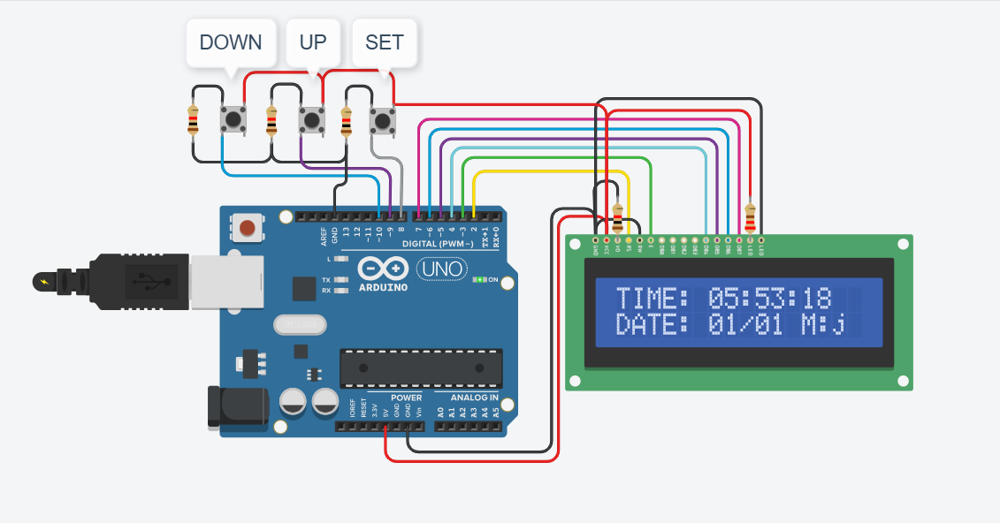

# arduino-digital-clock

An interactive digital clock and calendar system built using an Arduino Uno microcontroller, a 16x2 character LCD display, and tactile push-buttons for manual time and date adjustment.

## How It Works

* **Microcontroller Processing & Timekeeping:** An Arduino Uno executes firmware code that tracks seconds, minutes, hours, days, and months using software timers. The microcontroller processes incoming control inputs and updates the real-time display data.
* **16x2 LCD Interface:** Connected in 4-bit parallel mode to digital I/O pins on the Arduino Uno to conserve micro-controller pin access. The display renders real-time parameters on two lines: line 1 shows `TIME: HH:MM:SS` and line 2 displays `DATE: DD/MM`.
* **Push-Button Navigation Interface:** Includes three tactile switches wired with pull-up resistors to digital input pins for user configuration:
  * **SET:** Toggles through programming modes (setting hours, minutes, day, month).
  * **UP:** Increments the selected time/date value during adjustment.
  * **DOWN:** Decrements the selected time/date value during adjustment.
* **Power Distribution & Potentiometer Contrast:** Power ($+5\text{V}$) and ground ($\text{GND}$) are distributed directly from the Arduino board. A potentiometer/resistor network manages LCD contrast and display pin logic.

## Hardware Components Used

* **Microcontroller:** Arduino Uno R3
* **Display:** 16x2 Character LCD (HD44780 compliant)
* **Inputs:** 3 × Tactile Push-Buttons (DOWN, UP, SET)
* **Passive Components:** Pull-up / Current-limiting Resistors & Potentiometer
* **Interconnects:** Prototyping Breadboard and Jumper Wires

## Key Technical Learnings
* Managed 4-bit parallel communications between an Arduino Uno and an LCD panel.
* Designed multi-button state-machine logic in C++ for adjusting system time values.
* Circuit wiring and debouncing handling for tactile button inputs.
